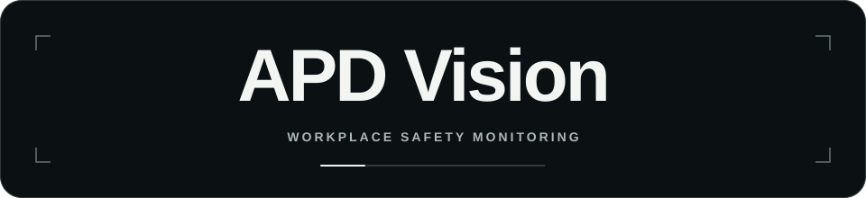

<div align="center">
  

  <p><strong>From camera feeds to reviewable PPE evidence.</strong></p>
</div>

https://github.com/user-attachments/assets/452c575c-35f2-4ce4-890a-d8fd45658670

APD Vision monitors the use of **helmets, vests, gloves, and shoes** in video footage. It associates detections with tracked workers, applies zone-specific PPE rules, and records events with photographic evidence and short clips. The dashboard provides Live monitoring, Analytics, Evidence, recorded-video analysis, and reports; the K3 Agent answers questions in Indonesian using available data.

> **Model limitation:** Helmets and vests are the default requirements that can trigger violations. Detection of gloves and shoes remains weak for small, distant, or occluded objects; neither is a strict violation trigger by default. The `shoes` class means closed-toe footwear, **not** certified safety footwear. A safety officer must review the results; they must not be treated as automated safety decisions.

## Key capabilities

| Area | Capabilities |
|---|---|
| Monitoring | RTSP/HTTP streams, simulated video, multiple cameras sharing an inference scheduler, and automatic reconnection when a source disconnects. |
| Recordings | Resumable uploads, server-side video files, analysis using the recording's start time, and jobs that can be paused, resumed, or cancelled. Simulated data is distinguished from live and recorded data. |
| Detection | YOLO pose and a PPE detector, PPE-to-body-part association, ByteTrack tracking, zone-specific rules, and **compliant / violation / uncertain** states with hysteresis. |
| Evidence | Annotated photographs, worker crops, short clips, face blurring, SHA-256 hashes, supervisor review, and an audit trail. |
| Analytics and action | Compliance by PPE item, camera, and zone; exposure minutes; before-and-after intervention analysis; camera quality; and printable K3 reports. |
| K3 Agent | Indonesian-language questions and answers, with figures obtained through read-only tools. Local Ollama and an offline router are available; cloud providers are optional. |
| Access and alerts | `viewer`, `supervisor`, and `admin` roles; user sessions, activity audits, and optional Telegram notifications. |

### Detection flow

```text
Camera / video → person + keypoint detection → PPE detection → worker association
               → zone-specific PPE rules → stable state → event + evidence → dashboard / alert
```

A PPE item is associated with a worker only when it is located in the appropriate body region. Insufficient evidence produces an **uncertain** state, not an automatic violation. False-positive reviews affect compliance statistics. A worker's identity is a tracking ID within a camera session, not face recognition.

## Architecture at a glance

- **Frontend:** React 18, TypeScript, and Vite; the dashboard and API share an origin in production.
- **Backend:** FastAPI, SQLModel, and SQLite; serves the API, MJPEG stream, authentication, evidence, and built frontend.
- **Pipeline:** YOLO11n-pose, a fine-tuned PPE model, OpenCV, and ByteTrack. A separate production worker handles camera inference, recording jobs, notifications, backups, and retention outside the API process.
- **Storage:** The database and evidence live under `backend/data/`, and model weights under `backend/weights/`; runtime data and secrets are not stored in Git.
- **Production:** Docker Compose with Caddy for HTTPS; the pipeline shares live status and frames with the API through a volume.

See the **[technical overview](TECHNICAL_OVERVIEW.md)** for module details, data flow, tables, security, and coding conventions.

```text
backend/     API, computer vision pipeline, worker, scripts, and tests
frontend/    React dashboard and Playwright tests
training/    notebooks and model preparation/evaluation utilities
deploy/      production Compose, Caddy, backups, and deployment checks
assets/      README assets
```

## Run locally

### Prerequisites

- Python 3.11, Node.js 20+, and npm.
- PPE weights at `backend/weights/best.pt` and pose weights at `backend/weights/yolo11n-pose.pt` for the camera pipeline. Weights are not in Git; Ultralytics can download the pose weights on first use.
- Ollama is optional for the K3 Agent; questions supported by the offline router can still be answered without it.

### Backend

From the repository root:

```bash
cd backend
python3 -m venv .venv
source .venv/bin/activate
pip install -r requirements.txt -r requirements-dev.txt
# Copy the example config only if .env does not exist; do not overwrite local secrets.
if [ ! -f ../.env ]; then cp ../.env.example ../.env; fi
# Configure ../.env before creating an account.
python -m scripts.users add admin-lokal --role admin
uvicorn app.main:app --reload --port 8000
```

Adjust `.env` for your environment before starting the server. To use a local model for the K3 Agent, start Ollama and download the configured model (for example, `ollama pull qwen2.5:7b`). On Apple Silicon macOS, the native backend can use `mps`; Docker on Mac uses the CPU.

> **Do not run `scripts.seed_demo --force` against a database containing real data.** To populate sample data, use a separate database and run `python -m scripts.seed_demo` without `--force`.

### Frontend

In another terminal, from the repository root:

```bash
cd frontend
npm ci
npm run dev
```

Open **http://localhost:5173**. Vite proxies `/api` and `/evidence` to the backend on port 8000. For a production build, run `npm run build`; FastAPI serves `frontend/dist` at http://localhost:8000.

### Enable the camera pipeline

1. Place the active PPE model at `backend/weights/best.pt` and check `models.ppe` and `class_map` in `backend/config.yaml`.
2. Register a camera or video through the dashboard, or configure a source for local use.
3. Run the backend with `RUN_PIPELINE=1` during development. Alternatively, to process one recording without the server, run `python -m scripts.process_video --source data/videos/rekaman.mp4 --start 2026-10-20T08:00` from `backend/` (adjust the path and recording start time).

### Docker demo and production

```bash
# Local demo (CPU); create .env from .env.example if it does not exist,
# then configure the initial account and other required settings.
docker compose up --build
```

For production, set `DOMAIN`, the initial credentials, and secrets in `.env`, then run:

```bash
docker compose --env-file .env -f deploy/docker-compose.prod.yml up -d --build
```

The demo is available at **http://localhost:8000**. Production uses Caddy/HTTPS; before exposing it publicly, configure the domain, secrets, backups, and retention policy. The initial account does not require `DASHBOARD_PASSWORD` to remain in `.env` after bootstrap.

## Testing

```bash
cd backend && python -m pytest -q
cd ../frontend && npm ci && npm run build
npx playwright install chromium  # once on a new machine
npx playwright test --project=chromium
```

Playwright starts a test server and uses a temporary database; it does not access the operational database. Tests cover login and roles, Live, Evidence and reviews, analytics, recording uploads and jobs, the Agent, settings, admin pages, and mobile layouts.

## Training and evaluation

Notebooks and scripts are available in `training/`. A trained model remains a **candidate** until it passes evaluation against a gold test set kept separate from the training data. `training/evaluate_model.py` reports per-class mAP; `training/promote_model.py` checks the promotion gate before replacing `backend/weights/best.pt`. Never train on the gold test set.

- [SH17](https://github.com/ahmadmughees/SH17dataset) — CC BY-NC-SA (non-commercial).
- [PPE Dataset for Workplace](https://universe.roboflow.com/siabar/ppe-dataset-for-workplace) — CC BY 4.0.
- Locally annotated data.

**Evaluation limitation:** On a reviewed 340-frame gold set, the active model achieves a mean mAP50-95 of **0.277** (helmet 0.604; vest 0.432; gloves 0.045; shoes 0.026). The four-class promotion gate has not been met. These figures must not be presented as evidence that all four PPE classes are ready for field deployment; performance must be reevaluated using the target site's cameras and conditions. A local MacBook M1 benchmark (`mps`, 1080p video) recorded approximately 11.9 checks per second per camera with one camera and 5.7 with two; three or four cameras require more capable hardware or configuration changes.

## License and use

APD Vision is a personal portfolio project, not an open-source project. Its original code, documentation, and materials are protected; copying, modifying, reusing, or distributing them requires written permission. See [LICENSE](LICENSE). Third-party dependencies, models, datasets, fonts, and assets remain subject to their respective licenses.
